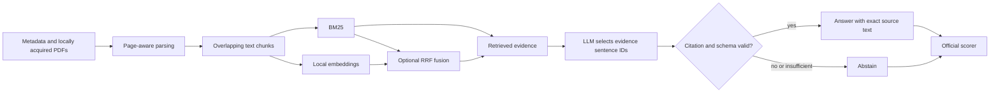

# WattBot 2026: Evidence-Grounded RAG

A reproducible retrieval-augmented question answering system for the [Kaggle WattBot 2026 competition](https://www.kaggle.com/competitions/WattBot2026). It retrieves evidence from research papers and public reports, returns source-linked answers, validates quotations programmatically, and abstains when the evidence is insufficient.

## What this project demonstrates

- Reproducible acquisition of pinned arXiv documents from the sanctioned Cornell/Kaggle GCS mirror, with checksum and manifest validation.
- Page-aware PDF extraction, text chunking, and corpus audits.
- A transparent BM25 baseline, local dense retrieval, and reciprocal-rank fusion (RRF) hybrid retrieval.
- Evidence-grounded generation: the model selects sentence IDs; application code maps them to exact source sentences and rejects invalid citations.
- A command-line workflow for indexing, prediction, and evaluation with the competition's official scorer.

## Architecture



## Measured results

All numbers below come from local runs with the supplied, unmodified competition scorer. The answer-generation result is on a **192-question development split** drawn from the training set. This split was used during iteration, so it is not a blind validation result.

| Experiment | Measured result | Interpretation |
| --- | --- | --- |
| BM25 V2.1 answer generation | Official score **0.697292**; answer values correct **128/192**; citation F1 **0.736458** | Current best measured answer pipeline on the development split |
| Dense document retrieval | Recall@5 **0.9379** | Highest Recall@5 among the compared retrievers |
| BM25 + dense RRF retrieval | MRR@5 **0.9412**; Recall@20 **1.0000** | Stronger rank metrics on a 51-answerable-question retrieval holdout, but slower |
| Hybrid answer generation | Official score **0.675677**; answer values correct **123/192**; citation F1 **0.726042** | Did not outperform BM25 end to end |

On the 192-question BM25 answer run, mean end-to-end latency was **3.57 seconds** and P95 was **4.65 seconds** on the local machine. These are observed single-run measurements, not a service-level guarantee. The answer runs used a locally served `gpt-oss:20b`; no paid inference API was used.

## Error analysis

Reviewed failures show several recurring categories:

- Numeric scale and unit handling, including per-item versus aggregate quantities.
- Range questions where both endpoints or the correct tolerance convention matter.
- Selecting a nearby but broader or narrower statistic from the same source.
- Correct source retrieval without sufficient evidence passage selection or reasoning.
- Abstention calibration: some answerable questions were refused, while some unsupported answers were accepted.
- Citation precision and recall trade-offs between retrieving candidate sources and citing only the sources that support the final answer.

These categories are qualitative observations from the reviewed development runs. No per-question examples or counts are published here.

## Quick start

Use Python 3.11 or newer and install the project:

```powershell
uv sync
```

Join the Kaggle competition and download its files to `data/competition/`. The competition data and PDFs are not included in this repository. Then acquire the arXiv documents using the sanctioned mirror route, parse PDFs, and create page-aware chunks:

```powershell
uv run wattbot audit --data-dir data/competition
uv run wattbot download-arxiv-mirror --data-dir data/competition --pdf-dir data/pdfs
uv run wattbot parse-pdfs --data-dir data/competition --pdf-dir data/pdfs --out data/processed/pages.jsonl
uv run wattbot chunk --pages data/processed/pages.jsonl --out data/processed/chunks.jsonl
```

Build and compare retrieval indexes:

```powershell
uv run wattbot evaluate-retrieval --data-dir data/competition --chunks data/processed/chunks.jsonl --k 5 10 20
uv sync
uv run wattbot build-dense-index --chunks data/processed/chunks.jsonl --output data/indexes/nomic-embed-text-v1.5.npy
uv run wattbot evaluate-dense --data-dir data/competition --chunks data/processed/chunks.jsonl --vectors data/indexes/nomic-embed-text-v1.5.npy --k 5 10 20
uv run wattbot evaluate-hybrid --data-dir data/competition --chunks data/processed/chunks.jsonl --vectors data/indexes/nomic-embed-text-v1.5.npy --k 5 10 20 --rrf-k 60
```

Dense embeddings use a local Ollama service and `nomic-embed-text:v1.5`. Answer generation can use a local Ollama chat model. See `.env.example` for supported endpoint variables and the CLI help for prediction and scoring commands.

## Reproducibility and limitations

- Training questions are split deterministically by question ID for local development and holdout evaluation. The 192-question development results have been used during iteration.
- The retrieval holdout contains only 51 answerable questions; retrieval metrics compare ranked source IDs and do not establish answer correctness.
- Eleven source metadata URLs did not pin an arXiv version. The local acquisition process records the selected mirror version; the historical version used by competition organizers cannot be confirmed for these entries.
- PDF text extraction does not guarantee that all tables and figures are represented correctly.
- Local latency depends on hardware, model serving, and loaded model state.

## Data and competition rules

Download competition data through Kaggle after accepting the competition terms. This repository contains code and aggregated measurements only. Do not commit competition CSVs, downloaded PDFs, extracted text, vector indexes, predictions, or reports that reproduce individual questions, answers, or evidence. Source PDFs may have separate licenses; check each source's terms before redistribution.

During the active competition, public sharing of competition code must also follow the [WattBot competition rules](https://www.kaggle.com/competitions/WattBot2026/rules), including sharing through the competition's Kaggle discussion forum or notebook and using an OSI-approved license that permits commercial use.
